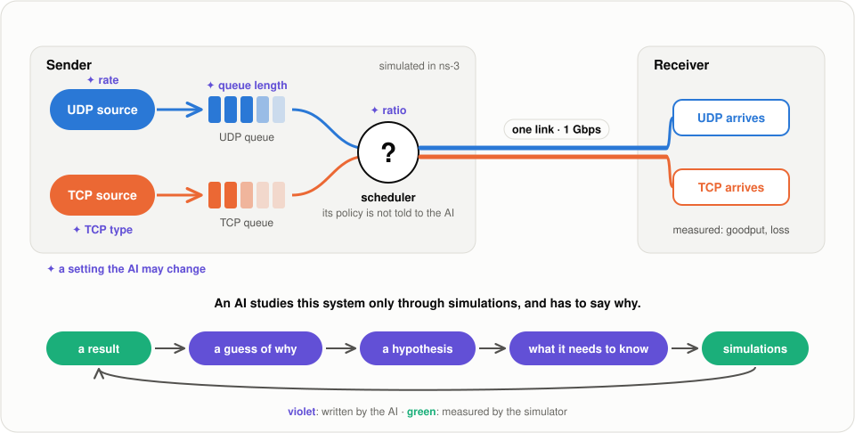

# An AI research loop over ns-3 network simulations

<em>The first network the loop worked on (two hosts, one link). Any network can now be described in a brief.</em>

A local language model (the researcher) is asked a networking question about a simulated network it cannot see inside.
The network is described in a brief: the original two hosts and one link (`scratch/two-hosts`), or any network built
from a description of hosts, links, queues, schedulers and flows (`scratch/net`, drawn and edited in the page's network
builder). The researcher works only through a ledger, along a fixed chain: a result -> its informed guesses of why it
came out so (whys) -> a hypothesis -> a test whose decision rule is stated before the simulations, with a rival
explanation under which it would fail -> evidence from ns-3 -> a verdict. It can also look before it simulates: read
what a simulation recorded, compute measurements of its own, or have a run recorded again more finely (a probe).

Sessions run in one of three arms: one AI ("hypotheses", the default), the same loop without the hypothesis format
("plain", for comparison), or two AIs ("supervised"): a second model call, the supervisor, asked apart from the
researcher, reads each guess against its records, reviews each test before it runs and rules on what the checks mean.
The harness runs the experiments and checks the rules from the measured numbers; a viewer shows what the numbers did,
why each run was chosen, and what each agent was given and wrote. This repository is a snapshot of the working folder
(`~/project` on the research server). Changes under review before they go live are on the branch
`review/harness-2026-11-22` (its `REVIEW.md`); plans waiting for a decision are in `plans/`.

## What is where

| Path | What it is |
|---|---|
| `HARNESS_SPEC.md` | The specification: the system as it is (rewritten as a whole on 2026-11-12), with the results so far, the open items and every source file |
| `EVIDENCE_VIEW.md`, `PAGE_REDESIGN.md` | The operator's two plans the viewer was built from: what the evidence page must show, and how one page serves the whole cycle of work |
| `scratch/two-hosts/` | The first ns-3 scenario: `two-hosts.cc` and the scheduler `link-queue-disc.{h,cc}` (a copy; it is built inside an ns-3.49 tree) |
| `scratch/net/` | The ns-3 program that builds any network from a description (hosts, links, queues, schedulers, flows) and runs it; the briefs with a `topology` use it (a copy, built inside an ns-3.49 tree) |
| `briefs/<id>.json` | A brief: the assignment a person writes before a session. A plain-language description of the system (the task sentence is written by the harness from the aim and the open settings, `tools.task_text`; a brief made before 2026-11-17 states its own), the fixed settings (`system`), the settings the model may change (`knobs`: any option of the program, each with a range and a default, a numeric one optionally with a `step` its values are rounded to), the goal (open, or a target with conditions and optionally a `tolerance` in per cent) and the limits |
| `harness/loop.py` | The loop: builds the prompt from the ledger, asks the model once per turn, does what its answer asks. A turn may state whys and hypotheses, drop them, give verdicts and design one experiment of several simulations, run at once; each simulation must serve a tested hypothesis, and one experiment may use at most half of the simulations that are left. `--brief <id>` chooses the brief of a new session, `--session <id>` the session (default: a new id `sNNN`) |
| `viewer/vendor/joint.min.js` | JointJS 4.3.4 (`@joint/core`), the open-source diagram library the network builder draws on; unchanged, with its licence (MPL-2.0) beside it in `joint.LICENSE.txt` |
| `harness/decision_rules.py` | The decision rules of a test experiment: comparisons the model states before the simulations run (`measure@label > 1.1 * measure@other AND ...`), read and checked by the harness itself. Each comes with a rival explanation under which it would fail; one that would hold under the rival too is refused |
| `harness/tools.py` | Everything the model can reach: read-only tools and `run()`. Every path is inside the current session's folder; a run id is accepted only if that session's own index lists it |
| `harness/manifest.json`, `prompt.txt`, `schema.json` | What is the same for every brief (the outputs and the tools, described), the prompt, the answer format. The format's `params` object is built from the session's brief when the session starts: one property per knob, all required, so every design states every knob |
| `harness/score.py` | Operator tool: `score.py <session>` scores a finished session against the sweep of its brief and scheduling policy |
| `harness/check_objects.py` | Operator tool: compares the viewer's picture of the system (`viewer/objects.json`, `viewer/evidence_system.js`) with the scenario source, value by value; run it after every change of the scenario |
| `harness/audit.py` | Operator tool: `audit.py <session>` writes `checks/audit/<session>.json`: which checks are void (their decision rule compared a simulation with itself), which verdicts rest only on those, which knobs an experiment lists as varied without varying them, which knobs a design does not state |
| `harness/session_figures.py` | Figures counted from a session's records (verdicts against checks, the checks in order, simulations returned, simulations no decision rule names), which `control.py` puts in each session's row for Home and Compare |
| `harness/control.py` | The small server for the viewer (port 8600), shared by every account of the machine (one session at a time; see "Using the page together"): lists sessions and briefs, starts sessions, operator runs and sweeps, saves new briefs; `make_trace.py` records packet events |
| `sessions/<id>/` | One session = one complete attempt by the model, in its own folder; sessions know nothing about each other. `s001` is the first session (2026-11-09) |
| `sessions/<id>/ledger.jsonl` | The session's record: draft (a short record: length and token count; the text is in `drafts.jsonl`), hypothesis, drop, experiment, simulation, evidence (one line per simulation), check (a decision rule with the measured numbers, held or failed), verdict, request and result (a tool request and what came back), note, malformed. Each record has `by`: who produced it (`model`, the researcher; `supervisor`; `harness`; `simulator`; `operator`), written by the harness. `s001` is in the earlier format: one simulation per experiment, no checks |
| `sessions/<id>/runs/index.json` | The session's own simulations, the only ones its tools can see: id, params, metrics |
| `sessions/<id>/runs/<run>/` | One simulation: `params.json`, `metrics.json`, `series.csv` (a sample every 0.1 s) |
| `sessions/<id>/session.json` | What the session was given (`given`: its brief with the description filled in, plus the output and tool descriptions), the model, the start time and the flags; at the end: when and how it ended (`how`), the report's ledger id, and the hypotheses left open. `s001` was made before briefs and has none |
| `sessions/<id>/drafts.jsonl`, `calls.jsonl` | What each agent was given and wrote, word for word: kept on the lab machine and shown on the page's Agent transcripts, not in the repository (since 2026-11-22) |
| `sessions/<id>/answers.jsonl` | Each turn's accepted answer as it was received (the JSON content only), before any part of it was refused: what was asked, to compare with what was run. Sessions from `s020` on |
| `sessions/<id>/report.json` | The model's final report, as accepted by the harness: goal, recommendation, expected values, explanation, when it holds and breaks, claims with the ledger ids that support them, open questions |
| `checks/` | Operator-only: nothing here is reachable through `harness/tools.py` |
| `checks/operator.jsonl` | The scheduling policy (how the scheduler divides the link: share or cap) and the run time of every simulation, by session and run. The policy reaches the simulation as the environment variable `TWOHOSTS_SCHED`, not as an option. Lines written before 2026-11-11 call it `mode` |
| `checks/build1/` | The operator's first checks of both scheduling policies (`sanity-*`, `share-*`, `cap-*`), with their `index.json` |
| `checks/build2/`, `checks/build3/` | Operator checks of the revised simulator, with the command of each and `results.json` (checks 1 to 11 in `build3`) |
| `checks/sweeps/<id>/` | A sweep: every combination of a grid of knob values for one brief and one scheduling policy, run by the control server (`POST /api/sweep`). `table.csv` has one row per simulation, `status.json` the progress |
| `checks/keys/<brief>.json` | The answer key of a brief: which sweep belongs to which scheduling policy, notes, and the checklist a session is judged by |
| `checks/audit/<session>.json` | The audit of a session's records, written by `harness/audit.py` |
| `checks/scores/<session>.json` | The score of a finished session, written by `harness/score.py`: best row of the sweep for the goal, the model's recommendation against it, simulations used, the checklist with the operator's judgements and notes (made with `score.py --judge` or on the Operator tab) |
| `trace/` | Short packet-level event recordings made by the operator |
| `viewer/` | The viewer: `index.html` + the `evidence_*.js` files are the evidence page, one page for the whole cycle (Home, new session, a session's page, compare, review, export). Earlier pages, kept working: `index_runs.html` + `adrs_view.js` (the run page), `index_full.html` + `adrs_view_full.js` (six pages, with the system diagram and the packet events), `index_old.html` |

## Not in the repository

The ns-3.49 source tree and its build, the per-run `flowmon.xml` files, packet captures, the agents' word-for-word
transcripts (`drafts.jsonl`, `calls.jsonl`), and the server's visit log (`checks/visits.jsonl`). The harness expects the
project at `~/project` with ns-3 built in `~/project/ns-3.49`, and a model served at `http://127.0.0.1:18000/v1`,
so the Python parts read here but do not run without those.

## Using the page together (a lab)

The control server answers only on `127.0.0.1` of the machine it runs on. Everybody who has an account on that machine
can use the same page from their own computer through an SSH tunnel, with nothing to install:

    ssh -N -L 48600:127.0.0.1:8600 <your account>@<the server>

and then open `http://127.0.0.1:48600/viewer/`. The foot of every view shows this line with the server's own name.
Whoever opens the page can do what its owner can: read every session, set up a brief, start a session, review. Three
rules keep people out of each other's way (`harness/control.py`):

- **One session at a time.** While a session is running, a new one is not started. Home, the set-up page and the
  running session's banner say which session is running and which account started it.
- **A running session is stopped by the account that started it, or by the owner of the page**, nobody else.
- **Every start, stop and saved brief is noted** with the account in `checks/people.jsonl` (kept out of git and out of
  exports, because it holds account names).

**To look only, with no tunnel** (a browser on a computer or a phone, on the same network as the server or on its
VPN): start the server with `python3 harness/control.py --network on` and open `http://<the server>:8600/viewer/`.
A visitor who comes that way can read the page and nothing else: every POST is refused, only the page's own folders
are given (`viewer/`, `sessions/` without the drafts, `briefs/`, `trace/`, `checks/` without the list of accounts
and the exports), and no folder is listed. The bar then says "view only". Without `--network on` the server answers
on `127.0.0.1` alone.

**A personal link** lets one person use the page fully from the network, with no tunnel and no account:
`python3 harness/invite.py NAME` prints the page's address with a long key. Opened once in a browser (a computer or a
phone), the key is kept in a cookie of that browser and taken out of the address; from then on that visitor is NAME
and can do what the owner can. `invite.py --list` shows who has a link, `invite.py --remove NAME` ends one at once.
The keys are in `checks/access.json` (the owner's file; not in git, never given over HTTP). The key travels over
plain HTTP, so give a link only to somebody you would let work under your account.

Sessions started through the page run under the account that runs the control server and use its model server.
The draft files (`drafts.jsonl`) are given to nobody over HTTP.

## Updating

`./snapshot.sh` re-copies the scenario and the specification and stages everything; then commit and push.
